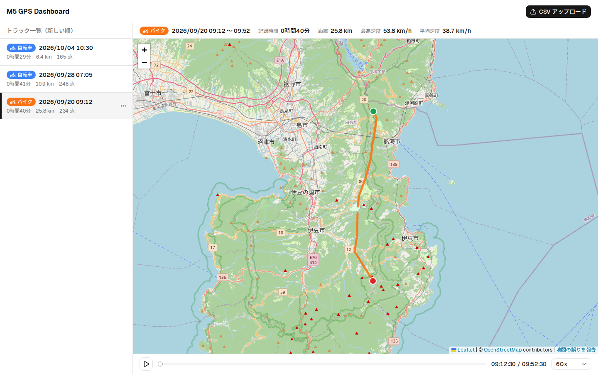
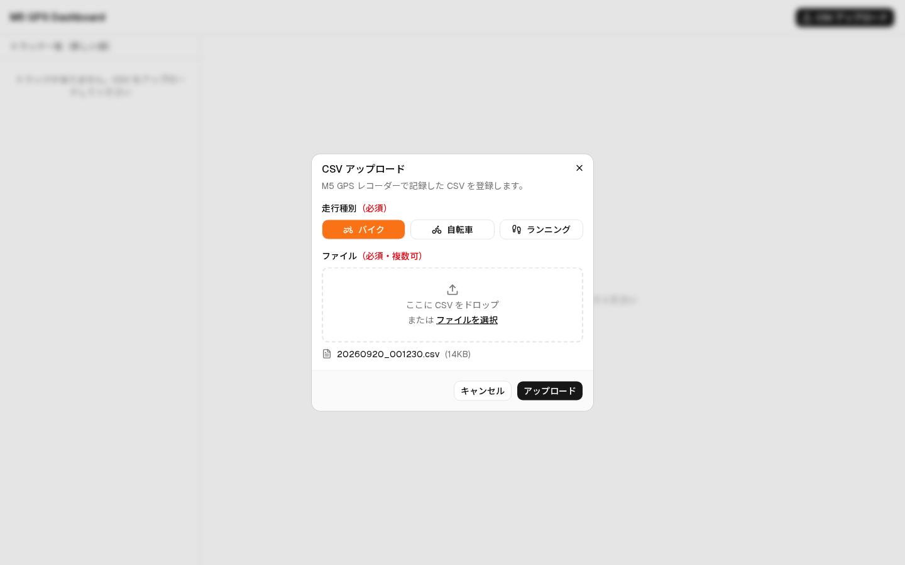
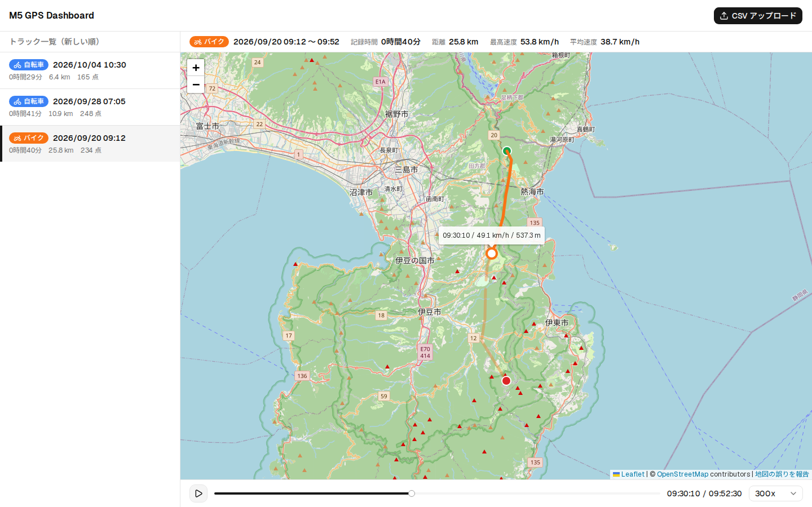
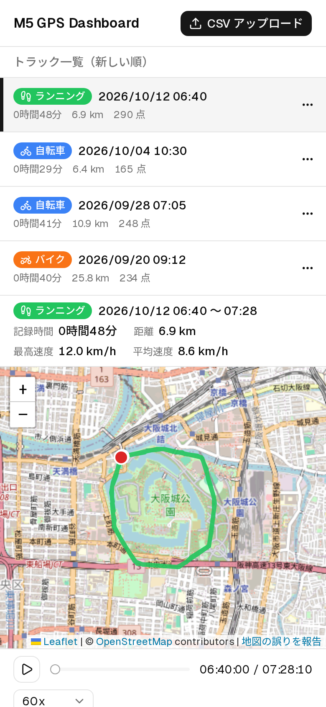

# M5+GPSによる走行記録アプリ

## 必要なHW資材

- M5 Stack Basic v2.7
- M5Stack用GPSユニット v1.1
- MicroSD 16GB

## Web ダッシュボード

M5 で記録した CSV をブラウザからアップロードし、地図上に走行軌跡を表示・再生する Web アプリ（`web/`）。
自宅サーバーで動かすことを想定している。仕様は [docs/ideas/web-dashboard-spec.md](docs/ideas/web-dashboard-spec.md) を参照。



### 使い方

1. M5 の microSD から CSV（`/tracks/YYYYMMDD_HHMMSS.csv`）を PC に取り出す
2. 「CSV アップロード」から走行種別（バイク / 自転車）を選んで CSV をアップロードする（複数ファイル可）

   

3. 左の一覧（記録開始日時の新しい順）からトラックを選ぶと、右の地図に軌跡が表示される
   - 軌跡の色はバイク = オレンジ、自転車 = 青。軌跡をクリックするとその地点の日時・速度・高度などを表示する
   - 一覧の「…」メニューから走行種別の変更・削除ができる
4. 地図の下の再生ボタン・スライダーで、走行を時間に沿って再生できる（10x〜600x）

   

スマートフォンでは一覧と地図を上下に並べて表示する。



> スクリーンショットは架空のルートのダミーデータ（`web/demo/`）で撮影している。
> 地図画像: © [OpenStreetMap](https://www.openstreetmap.org/copyright) contributors

---

### セットアップと起動

Node.js 24 で動作確認

```bash
cd web
npm install
cp .env.example .env   # 必要に応じて編集
npm run dev            # 開発サーバー: http://localhost:3000
```

### 自宅サーバーでの本番運用（Docker Compose）

リポジトリ直下で実行する。初回はイメージのビルドも行われる（ビルドにはネット接続が必要）。

```bash
cp .env.example .env    # 任意: ポートやタイル URL を変える場合
docker compose up -d    # http://<サーバー>:3000
```

| 操作                         | コマンド                               |
| ---------------------------- | -------------------------------------- |
| 状態の確認（healthy になる） | `docker compose ps`                    |
| ログの確認                   | `docker compose logs -f web`           |
| 更新（git pull の後など）    | `docker compose up -d --build`         |
| 停止                         | `docker compose down`                  |

- データ（SQLite・アップロードした CSV・変換済み GeoJSON）はリポジトリ直下の `./data` に保存される（Git 管理外）。コンテナを作り直しても消えず、バックアップはこのディレクトリをコピーするだけでよい
- コンテナは uid 1000（`node` ユーザー）で動く。`./data` は uid 1000 が書き込めるようにしておく（ホストのユーザーが uid 1000 でない場合は `sudo chown -R 1000:1000 data`）
- イメージは動かすマシンでビルドされる（better-sqlite3 のネイティブモジュールのため。x64 / arm64 の Linux に対応）
- 再起動ポリシーは `unless-stopped`（サーバーの再起動後も自動で起動する）
- **認証機能はないため、インターネットには公開せず LAN 内だけで使うこと**

| 設定（`.env`）         | 既定値                                           | 説明                                                         |
| ---------------------- | ------------------------------------------------ | ------------------------------------------------------------ |
| `WEB_PORT`             | `3000`                                           | 公開するポート                                               |
| `NEXT_PUBLIC_TILE_URL` | `https://tile.openstreetmap.org/{z}/{x}/{y}.png` | 地図タイルの URL（ビルド時に埋め込まれる。変更したら `--build`） |

### Docker を使わない場合

```bash
cd web
npm install
npm run build          # .next/standalone に単体で動くサーバーが作られる
DATA_DIR=/var/lib/m5-gps PORT=3000 HOSTNAME=0.0.0.0 npm run start:standalone
```

- **`DATA_DIR` は必ず `web/` の外の絶対パスを指定する**（既定の `./data` は起動ディレクトリからの相対パスで、standalone では `.next/standalone/data` になり、再ビルドで消える）
- better-sqlite3 はネイティブモジュールのため、**動かすマシン（CPU アーキテクチャ）と同じ環境でビルドする**（例: Raspberry Pi で動かすなら Raspberry Pi 上で `npm run build`）
- 常駐化は systemd などで行う

| 環境変数               | 既定値                                           | 説明                                           |
| ---------------------- | ------------------------------------------------ | ---------------------------------------------- |
| `DATA_DIR`             | `./data`                                         | データの保存先                                 |
| `NEXT_PUBLIC_TILE_URL` | `https://tile.openstreetmap.org/{z}/{x}/{y}.png` | 地図タイルの URL（**ビルド時**に埋め込まれる） |
| `PORT` / `HOSTNAME`    | `3000` / `0.0.0.0`                               | 待ち受けポート・アドレス                       |

開発用のコマンドやディレクトリ構成は [web/README.md](web/README.md) を参照。

## ライセンス

本リポジトリのソースコードは [Apache License 2.0](LICENSE) で提供する。

### 地図データ・地図タイル

- 地図データ: © [OpenStreetMap](https://www.openstreetmap.org/copyright) contributors
  - [Open Database License (ODbL)](https://opendatacommons.org/licenses/odbl/) で提供されている
  - 地図の右下に帰属表示を常に表示する（非表示にしないこと）
- 地図タイル: OpenStreetMap 財団の標準タイル（`https://tile.openstreetmap.org/{z}/{x}/{y}.png`）を利用する
  - [Tile Usage Policy](https://operations.osmfoundation.org/policies/tiles/) に従う
  - 主な制約: 帰属表示の明示、Referer の送信、キャッシュ迂回の禁止、一括ダウンロード・先読み・オフライン保存の禁止
  - 稼働保証（SLA）はなく、過度な利用は予告なく遮断されることがある
  - README のスクリーンショット（`docs/images/`）にも地図タイルが写っているため、帰属表示を含めた状態で掲載している
  - タイル URL は環境変数 `NEXT_PUBLIC_TILE_URL` で別の提供元に変更できる。変更する場合はその提供元の利用条件に従うこと

### 主な利用ライブラリ

| ライブラリ                       | ライセンス                |
| -------------------------------- | ------------------------- |
| Leaflet                          | BSD-2-Clause              |
| react-leaflet                    | Hippocratic License 2.1   |
| Next.js                          | MIT                       |
| shadcn/ui                        | MIT                       |
| Tailwind CSS                     | MIT                       |
| Drizzle ORM                      | Apache-2.0                |
| better-sqlite3                   | MIT                       |
| Radix UI                         | MIT                       |
| Lucide（アイコン）               | ISC                       |
| Sonner                           | MIT                       |
| Geist / Noto Sans JP（フォント） | SIL Open Font License 1.1 |
